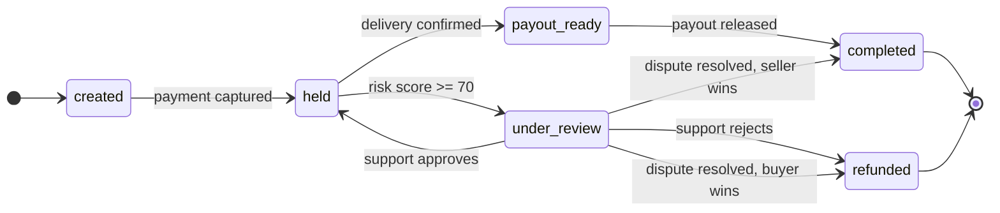

# trust-ledger

Escrow and dispute backend for a secondhand marketplace.

Money from a buyer is held by the platform until delivery is confirmed, then
paid out to the seller minus a commission. Risky orders are scored by a rule
engine and held for review. Every decision, automatic or human, is stored with
its reason.

I came from customer support, where answering "why is my money held" meant
checking four screens and still not finding the reason. This backend returns
that answer in one call, and it returns it twice over: the full reason for the
CS representative, and a separate line that is safe to send to the customer.
Risk rules are never exposed outside, because telling a customer which rule
fired teaches fraud rings exactly what to avoid.

## Contents

- [Order lifecycle](docs/01-order-lifecycle.md)
- [Money model](docs/02-money-model.md)
- [Architecture](docs/03-architecture.md)
- [Database](docs/04-database.md)

## How it works



## Money model

Balances are never stored in a column. Every transaction is a set of entries
that must sum to zero, and a balance is summed from those entries.

A payment of 50.00 EUR with a 5% platform fee:

| transaction        | account          | amount |
| ------------------ | ---------------- | ------ |
| `payment_captured` | `buyer:42`       | -50.00 |
| `payment_captured` | `escrow:order_1` | +50.00 |
| `payout_released`  | `escrow:order_1` | -50.00 |
| `payout_released`  | `seller:77`      | +47.50 |
| `payout_released`  | `platform:fee`   | +2.50  |

Invariants covered by specs: every transaction sums to zero, and the escrow
account of a finished order is empty.

## Authentication

Every request needs `Authorization: Bearer <token>`, except `/health` and
`/metrics`, which monitoring calls without an account. The role is read from the
database, never from a header the caller controls.

| role      | who it is                    | what it may do                     |
| --------- | ---------------------------- | ---------------------------------- |
| `buyer`   | the buyer of an order        | create orders, open a dispute      |
| `seller`  | the seller of an order       | open a dispute                     |
| `system`  | payment provider and courier | payment and delivery webhooks      |
| `support` | a CS representative          | payouts, refunds, resolve disputes |

## API

| Method | Path                       | What it does                                    |
| ------ | -------------------------- | ----------------------------------------------- |
| POST   | `/orders`                  | create an order                                 |
| POST   | `/orders/:id/payment`      | capture the payment, score the risk, hold money |
| POST   | `/orders/:id/delivery`     | courier confirms delivery                       |
| POST   | `/orders/:id/payout`       | release the payout minus the fee                |
| POST   | `/orders/:id/refund`       | return the money to the buyer                   |
| POST   | `/orders/:id/disputes`     | buyer or seller opens a dispute                 |
| POST   | `/disputes/:id/resolve`    | support decides                                 |
| GET    | `/support/cases/:order_id` | the whole case in one call                      |
| GET    | `/support/cases`           | the queue of orders waiting for a human         |
| GET    | `/metrics`                 | numbers a support lead looks at                 |
| GET    | `/health`                  | liveness and database check                     |

Every endpoint that moves money also requires an `Idempotency-Key` header and
returns `400` without one.

## The support endpoint

A status field says `pending` and stops there. It does not say why this order
and not the next one, where the money actually sits, or what the CS
representative is allowed to do about it. This endpoint answers all three, and
hands over a customer safe sentence so the reply does not have to be improvised.

```json
GET /support/cases/4

{
  "order": { "id": 4, "state": "held", "amount": "200.00", "risk_score": 65 },
  "why_held": [
    { "rule": "new_account_high_value", "points": 40,
      "explain": "Seller account is 1 days old and the order is above 40 EUR" },
    { "rule": "high_value_order", "points": 25,
      "explain": "Order amount is above 100 EUR" }
  ],
  "customer_message": "We are holding the payment. It goes to the seller once delivery is confirmed.",
  "timeline": [
    { "at": "2026-11-17T02:04:58Z", "event": "held", "actor": "system",
      "reason_code": "payment_captured" }
  ],
  "money": {
    "buyer_paid": "200.00", "held_in_escrow": "200.00",
    "paid_to_seller": "0.00", "platform_fee": "10.00"
  },
  "available_actions": [
    { "action": "approve_payout", "endpoint": "POST /orders/4/payout" },
    { "action": "refund_buyer",   "endpoint": "POST /orders/4/refund" }
  ],
  "sla": null
}
```

`why_held` stays inside the company. `customer_message` is the only part meant
to leave it, and a spec enforces that it never names a rule.

## Risk rules

No machine learning. A human has to be able to read the reason out loud.

| rule                        | points | condition                                      |
| --------------------------- | ------ | ---------------------------------------------- |
| `new_account_high_value`    | 40     | seller younger than 7 days and amount above 40 |
|