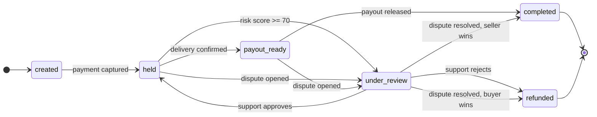

# Order lifecycle

Money is held by the platform until delivery is confirmed. Every transition
below is appended to `order_events` with an actor and a reason code.

`completed` and `refunded` are final. The state machine refuses every other
transition, which is covered by specs in `spec/models/order_spec.rb`.
