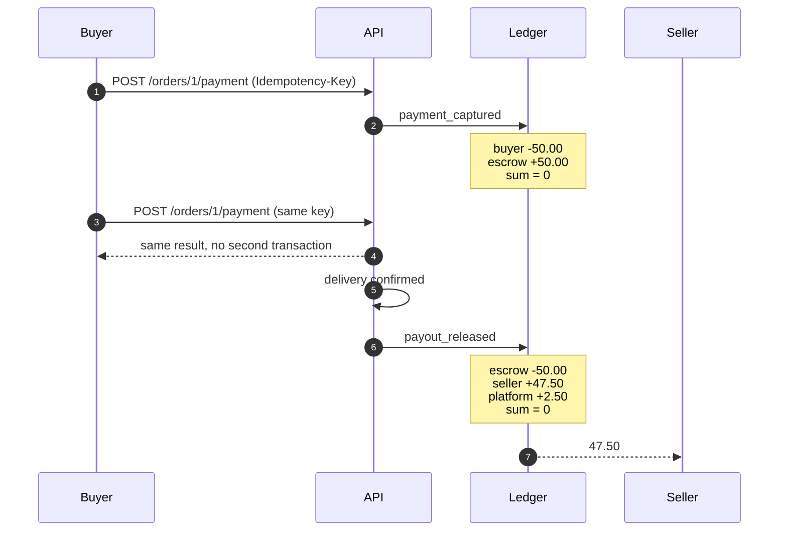

# Money model

Balances are never stored in a column. They are summed from `ledger_entries`,
and every transaction must sum to zero.

An unbalanced set of entries raises before anything is written, so a partial
transaction can never exist.
